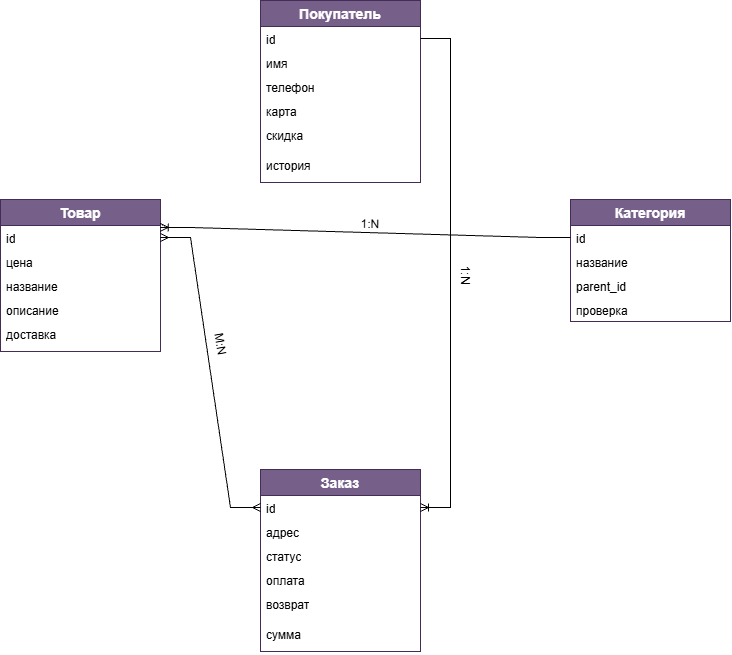

# Анализ и моделирование данных предметной области

## 1. Описание предметной области
Предметная область: интернет-магазин.

Назначение: покупка и продажа товаров и отслеживание их местоположения через Интернет.

Основные пользователи:
- покупатели, приобретающие товары;
- продавцы, выставляющие товары.

Основные процессы:
- ведение каталога товаров;
- работа с категориями;
- формирование корзины;
- оформление и обработка заказов.

Основные задачи информационной системы:
- хранение информации о покупателях;
- хранение информации о товарах;
- распределение товаров по категориям;
- обработка информации о заказах;
- просмотр истории заказов.

## 2. Объекты данных
В предметной области были выделены следующие объекты данных:

### Объект 1: Покупатель
Пользователь интернет-магазина, который приобретает товары.

Какая информация должна храниться: ФИО, номер телефона, карта оплаты, персональная скидка, история заказов.

### Объект 2: Товар
Объект интернет-магазина, выставленный на продажу.

Какая информация должна храниться: цена, название, описание, срок доставки.

### Объект 3: Категория
Группа товаров интернет-магазина со схожими характеристиками.

Какая информация должна храниться: название, иерархия, содержимое категории.

### Объект 4: Заказ
Запрос покупателя на покупку товара в интернет-магазине.

Какая информация должна храниться: ФИО покупателя, адрес доставки, статус заказа, способ оплаты, условия возврата.

## 3. Атрибуты объектов
Для каждого объекта были определены основные атрибуты и предполагаемые типы данных.

### Покупатель
| Атрибут | Тип данных | Описание                              |
|:-------:|:----------:|---------------------------------------|
| id      | Число      | Уникальный идентификатор пользователя |
| имя     | Строка     | ФИО пользователя                      |
| телефон | Строка     | Номер телефона пользователя           |
| карта   | Строка     | Карта оплаты пользователя             |
| скидка  | Логические | Персональная скидка пользователя      |
| история | Список     | История заказов пользователя          |

### Товар
|  Атрибут | Тип данных | Описание                        |
|:--------:|:----------:|---------------------------------|
| id       | Число      | Уникальный идентификатор товара |
| цена     | Число      | Стоимость товара                |
| название | Строка     | Название товара                 |
| описание | Строка     | Описание товара                 |
| доставка | Дата       | Срок доставки товара            |

### Категория
|  Атрибут  | Тип данных | Описание                                          |
|:---------:|:----------:|---------------------------------------------------|
| id        | Число      | Уникальный идентификатор категории                |
| название  | Строка     | Название категории                                |
| parent_id | Число      | Ссылка на родительскую категорию                  |
| проверка  | Логические | Проверка условий для включения товара в категорию |

### Заказ
|  Атрибут |  Тип данных  | Описание                        |
|:--------:|:------------:|---------------------------------|
| id       | Число        | Уникальный идентификатор заказа |
| адрес    | Строка       | Адрес доставки покупателя       |
| статус   | Справочные   | Статус заказа                   |
| оплата   | Логические   | Проверка оплаты заказа          |
| возврат  | Справочные   | Наличие возможности возврата    |
| доставка | Дата и время | Доставка заказа                 |
| сумма    | Вычисляемые  | Итоговая сумма заказа           |

## 4. Классификация данных
Выделенные данные можно классифицировать по их назначению и типу.
| Категория данных |                                               Примеры                                              | Назначение                             |
|:----------------:|:--------------------------------------------------------------------------------------------------:|----------------------------------------|
| Текстовые        | ФИО пользователя, номер телефона, карта оплаты, названия и описания товаров, адрес доставки заказа | Хранение текстовой информации          |
| Числовые         | идентификаторы, цены товаров                                                                       | Хранение числовых значений             |
| Даты и время     | срок доставки товара, доставка заказа                                                              | Хранение информации о датах событий    |
| Логические       | оплата заказа, вхождение товара в категорию                                                        | Проверка на соответствие условиям      |
| Справочные       | статус заказа, наличие возможности возврата                                                        | Хранение ранее заготовленных надписей  |
| Вычисляемые      | итоговая сумма заказа                                                                              | Рассчитывается на основе других данных |

## 5. Связи между объектами
Между объектами предметной области были определены следующие связи:

### Покупатель <–> Заказ
Тип связи: 1:N (один ко многим).

Один покупатель делает множество заказов. Каждый заказ приходит одному покупателю.

### Категория <–> Товар
Тип связи: 1:N (один ко многим).

Одна категория включает множество товаров. Каждый товар входит в какую-то категорию.

### Заказ <–> Товар
Тип связи: M:N (многие ко многим).

Один заказ может включать множество товаров. Каждый товар может входить в какой-то заказ.

## 6. Концептуальная модель данных

На концептуальной схеме отражены следующие связи:
- Покупатель 1:N Заказ
- Категория 1:N Товар
- Заказ M:N Товар

## 7. Оценка качества исходных данных
После построения концептуальной модели была выполнена оценка полноты и качества данных.

### Достаточно ли объектов выделено?
Да, выделенные объекты описывают основные данные, необходимые для описания покупателей, товаров, категорий и заказов.

### Отсутствуют ли важные сущности?
Для рассматриваемой модели основных сущностей достаточно, при дальнейшем развитии системы могут быть добавлены отзывы на товары, корзина и личный кабинет продавца как отдельный объект данных.

### Все ли необходимые атрибуты определены?
На данном этапе были определены основные атрибуты каждого объекта, при реализации реальной информационной системы список атрибутов может быть расширен.

### Имеются ли дублирующиеся данные?
Явного дублирования данных в модели нет, информация о покупателях, товарах, категориях и заказах хранится в отдельных объектах и связывается между собой.

### Достаточно ли информации для дальнейшего проектирования информационной системы?
Да, были выделены основные объекты, определены их атрибуты и связи, полученная модель может использоваться в качестве основы для дальнейшего проектирования информационной системы.

## Вывод
В ходе лабораторной работы была проанализирована предметная область интернет-магазина, были выделены основные объекты данных, определены их атрибуты и выполнена классификация данных. 

Между объектами были определены связи один ко многим (1:N) и многие ко многим (M:N), на основе проведённого анализа была построена концептуальная модель данных. 

Полученная модель описывает основные данные интернет-магазина и может использоваться в качестве основы для дальнейшего проектирования информационной системы.
